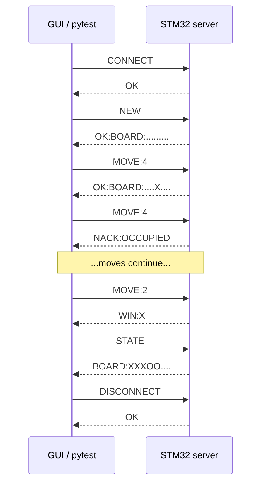
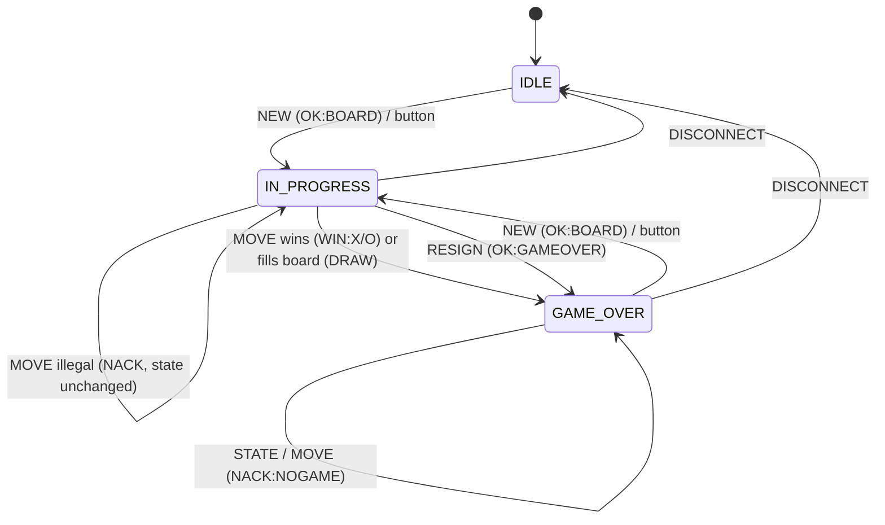

# STM32F051 Serial Game Server — Tic-Tac-Toe

**EEE3095S Embedded Systems II · CS Project 2026 · University of Cape Town**

An authoritative game server running on the UCT STM32F051 dev board, plus a thin Tkinter GUI client on the PC, talking over the board's ST-Link virtual COM port. **The STM32 is the referee**: it owns the board, whose turn it is and the game status, validates every request, and returns the authoritative result. The GUI only forwards clicks and redraws what the server confirms.

| | |
|---|---|
| Game | Tic-Tac-Toe (3 × 3) |
| MCU / board | STM32F051R8 on the UCT STM32 Dev Board v1.06 |
| Link | USART1 (PA9 TX / PA10 RX) via ST-Link V2.1 virtual COM port, 115200 8N1 |
| Firmware | C, STM32CubeIDE, HAL (init) + register-level RX interrupt |
| Client | Python 3 + Tkinter + pyserial |
| Tests | pytest + pyserial, 47 automated hardware tests (23 core + 24 for the extensions) |
| Extensions | CRC-8 frame checksum, built-in AI opponent (`NEW:AI`), move history and undo (`HISTORY`, `UNDO`) |
| Due | 27 October 23:59 |

**Team:** _<name 1>_, _<name 2>_ — _<task allocation: who did firmware / GUI / tests / report>_

---

## Contents
1. [Repository layout](#1-repository-layout)
2. [Hardware and pin map](#2-hardware-and-pin-map)
3. [Quick start](#3-quick-start)
4. [System architecture](#4-system-architecture)
5. [Server state machine](#5-server-state-machine)
6. [Message protocol](#6-message-protocol)
7. [Firmware design](#7-firmware-design)
8. [GUI client design](#8-gui-client-design)
9. [Automated tests](#9-automated-tests)
10. [Requirements traceability](#10-requirements-traceability)
11. [Troubleshooting](#11-troubleshooting)
12. [Known limitations and possible improvements](#12-known-limitations-and-possible-improvements)
13. [Submission checklist](#13-submission-checklist)
14. [References](#14-references)

---

## 1. Repository layout

```text
TicTacToeServer/
├── Core/                              # STM32CubeIDE application code
│   ├── Inc/
│   │   ├── main.h                     #   pin names, Error_Handler prototype (CubeMX generated)
│   │   ├── stm32f0xx_hal_conf.h       #   HAL module selection (CubeMX generated)
│   │   └── stm32f0xx_it.h             #   interrupt handler prototypes (CubeMX generated)
│   ├── Src/
│   │   ├── main.c                     #   ★ server: game logic, protocol, framing, LED, button
│   │   ├── stm32f0xx_it.c             #   ★ SysTick + register-level USART1 RX interrupt handler
│   │   ├── stm32f0xx_hal_msp.c        #   ★ USART1 pin setup + NVIC enable (without it RX never works)
│   │   ├── system_stm32f0xx.c         #   CMSIS system init
│   │   ├── syscalls.c                 #   newlib stubs
│   │   └── sysmem.c                   #   heap (_sbrk)
│   └── Startup/
│       └── startup_stm32f051r8hx.s    #   vector table + reset handler
├── Drivers/                           # ST HAL + CMSIS (vendor code, unmodified)
│   ├── CMSIS/
│   └── STM32F0xx_HAL_Driver/
├── python_gui/
│   ├── gui_client.py                  # ★ Tkinter GUI client
│   └── boot_test.py                   #   quick "is the board talking?" link check
├── tools/
│   └── hostsim/                       #   PC build of main.c + stubs: pre-flash check (not a board test), AI statistics
├── tests/
│   ├── conftest.py                    # ★ pytest fixture + CRC helpers: finds the board, resets it to a known state
│   ├── test_protocol.py               # ★ 23 core protocol / game-logic / robustness tests
│   └── test_extras.py                 # ★ 24 tests: checksum, AI opponent, history and undo
├── report/                            #   IEEE-format report (PDF + source) goes here
├── TicTacToeServer.ioc                # CubeMX configuration (pins, clocks, USART1)
├── STM32F051R8HX_FLASH.ld             # linker script
├── TicTacToeServer Debug.launch       # CubeIDE debug configuration
├── .project / .cproject / .mxproject  # CubeIDE project files (needed to import the project)
├── .settings/                         # CubeIDE workspace settings
├── .gitignore
└── README.md
```

★ = files you will actually read or edit. Folders `Debug/`, `EWARM/` and `STM32CubeIDE/` are build output or generator leftovers and are not needed to build.

---

## 2. Hardware and pin map

Everything used is on the UCT dev board; **no extra wiring and no USB-serial adapter**. One USB cable provides power, programming/debugging and the serial link.

| Function | MCU pin | Notes |
|---|---|---|
| USART1 TX → PC | **PA9** | to ST-Link `VCP_RX` |
| USART1 RX ← PC | **PA10** | from ST-Link `VCP_TX` |
| LED D9 **red** | **PB10** | via 150 Ω, active HIGH |
| LED D9 **green** | **PB11** | via 150 Ω, active HIGH |
| Button **SW0** | **PA0** | internal pull-up, pressed = LOW |
| SWD (programming) | PA13 / PA14 | handled by ST-Link |

Clock: HSI 8 MHz, no PLL (SYSCLK = HCLK = PCLK = 8 MHz). USART1 BRR gives about 115942 baud (0.64 % error), well within tolerance.

**Hardware behaviour**

| Server state | LED D9 | Button SW0 |
|---|---|---|
| IDLE | off | ignored |
| IN_PROGRESS, X to move | **red** | local "new game" (only while a PC session exists) |
| IN_PROGRESS, O to move | **green** | local "new game" |
| GAME_OVER | red + green **blinking** (150 ms) | local "new game" |
| Boot | 3 flashes of both colours | – |

> **LED colours on this board:** on the author's board the D9 red/green dies are physically swapped. `BOARD_RG_SWAPPED` at the top of `main.c` compensates in software. Set it to `0` on a board whose colours are correct.

When the button starts a game, the board also sends an **unsolicited** `OK:BOARD:.........` line so the GUI stays in sync.

---

## 3. Quick start

### 3.1 Prerequisites
- STM32CubeIDE (HAL package for STM32F0 is bundled)
- Python 3.9+ with Tkinter (included with the python.org installer)
- `pip install pyserial pytest`
- UCT STM32 dev board connected by USB; find its COM port in Device Manager → *Ports (COM & LPT)* → "STMicroelectronics STLink Virtual COM Port"

### 3.2 Build and flash the firmware
1. STM32CubeIDE → **File ▸ Import ▸ General ▸ Existing Projects into Workspace** → select this folder.
2. **Project ▸ Build Project** (configuration `Debug`).
3. **Run ▸ Debug** (or *Run*) using `TicTacToeServer Debug.launch`.
4. On reset the LED flashes 3 times, then the board prints:
   ```
   === Tic-Tac-Toe Server Ready ===
   Waiting for CONNECT...
   ```
   Check it with `python python_gui/boot_test.py COM14`.

### 3.3 Run the GUI
```powershell
cd python_gui
python gui_client.py
```
Pick the COM port → **Connect** → (optionally tick **Play vs AI**) → **New Game** → click cells. **Undo** takes back your last move (or the last pair vs the AI) and **History** lists the moves played. Close any other program using the port first (serial ports are exclusive).

### 3.4 Run the automated tests
Close the GUI first, then:
```powershell
cd tests
$env:SERIAL_PORT = "COM14"          # your port
python -m pytest -v test_protocol.py
```
Linux/macOS: `export SERIAL_PORT=/dev/ttyACM0 && pytest -v tests`.
Without `SERIAL_PORT` the tests are skipped (so they never fail on a machine with no board).

To run the **whole suite with a checksum on every request** (replies are verified too):
```powershell
$env:USE_CRC = "1"
python -m pytest -v
```

---

## 4. System architecture

```text
 ┌──────────────────────────┐   USB (ST-Link V2.1 VCP)   ┌────────────────────────────────┐
 │ PC                       │◄──────────────────────────►│ STM32F051R8  (SERVER)          │
 │  gui_client.py  (CLIENT) │   ASCII lines, 115200 8N1  │  USART1 RX ISR ─► ring buffer  │
 │   • sends requests       │                            │     ─► line framer ─► parser   │
 │   • draws server replies │                            │     ─► state machine + rules   │
 │  pytest (test harness)   │                            │     ─► reply on USART1 TX      │
 └──────────────────────────┘                            │  LED D9 (turn / game over)     │
                                                         │  Button SW0 (new game)         │
                                                         └────────────────────────────────┘
```

**Why the server owns everything (client-untrusted design).** The GUI never decides whether a move is legal and never infers state: a click becomes `MOVE:<i>`, and the board is redrawn only from a valid `OK:BOARD:` / `BOARD:` reply. This keeps a single source of truth, makes the server testable without a GUI, and means a buggy or malicious client cannot corrupt the game.

**Request/response flow (one request in flight):**



---

## 5. Server state machine

Three game states plus an orthogonal **session** flag (`connected`, set by `CONNECT`, cleared by `DISCONNECT`).



**Which command is accepted where**

| Command | IDLE | IN_PROGRESS | GAME_OVER | No session |
|---|---|---|---|---|
| `CONNECT` | OK | OK¹ | OK¹ | OK (opens session) |
| `NEW`, `NEW:AI` | OK:BOARD | `NACK:BADCMD` | OK:BOARD | `NACK:NOCONN` |
| `MOVE:…` | `NACK:NOGAME` | validated (see §6.4) | `NACK:NOGAME` | `NACK:NOCONN` |
| `STATE` | `NACK:NOGAME` | `BOARD:…` | `BOARD:…` | `NACK:NOCONN` |
| `HISTORY` | `NACK:NOGAME` | `HIST:…` | `HIST:…` | `NACK:NOCONN` |
| `UNDO` | `NACK:NOGAME` | OK:BOARD (or `NACK:NOUNDO`) | `NACK:NOGAME` | `NACK:NOCONN` |
| `RESIGN` | `NACK:NOGAME` | `OK:GAMEOVER` | `NACK:NOGAME` | `NACK:NOCONN` |
| `DISCONNECT` | OK | OK¹ | OK | `NACK:NOCONN` |
| anything else | `NACK:BADCMD` | `NACK:BADCMD` | `NACK:BADCMD` | `NACK:BADCMD` |

¹ Departure from the brief (justified): `CONNECT` is idempotent so a GUI can reconnect after a crash, and `DISCONNECT` aborts a running game so closing the GUI mid-game always returns the server to IDLE.

---

## 6. Message protocol

### 6.1 Framing
- ASCII, **case-sensitive**, **no spaces**.
- A frame ends at `\n` or `\r` (so `\r\n` works; the empty second terminator is ignored).
- **Maximum 63 characters** per frame (terminator excluded).
- Only printable ASCII (0x20–0x7E) is accepted inside a frame.
- **Optional checksum:** any frame may end in `*HH`, two hex digits of a CRC-8 (polynomial 0x07, initial value 0, no reflection, no final XOR) over everything before the `*`. `crc8("123456789") = 0xF4`. The suffix counts towards the 63 characters. See §6.6.
- Oversized or non-printable frames are **discarded up to the next terminator** and answered with exactly one NACK, so the tail of a bad frame can never run as a command.
- An unterminated frame is **discarded after 500 ms** of silence and answered with `NACK:TIMEOUT`.
- Board encoding: 9 characters, index 0–8 left-to-right, top-to-bottom; `.` empty, `X`, `O`. X always moves first.

```text
 0 | 1 | 2
---+---+---
 3 | 4 | 5          "XO.XO...."  =  X O .
---+---+---                         X O .
 6 | 7 | 8                          . . .
```

### 6.2 Commands (GUI → STM)

| Command | Meaning |
|---|---|
| `CONNECT` | open a session |
| `NEW` | start a new two-player game, X to move |
| `NEW:AI` | start a game against the built-in AI (you are X, the AI is O) |
| `MOVE:<index>` | place the side-to-move's mark at 0–8 |
| `MOVE:<index>:<X\|O>` | same, but the server rejects it with `NACK:NOTURN` if the mark is not the side to move |
| `STATE` | return the current board |
| `HISTORY` | return the moves played so far, in order |
| `UNDO` | take back the last move (the last pair of moves in AI mode) |
| `RESIGN` | forfeit the current game |
| `DISCONNECT` | end the session |

### 6.3 Responses (STM → GUI)

| Response | When |
|---|---|
| `OK` | `CONNECT`, `DISCONNECT` accepted |
| `OK:BOARD:<9>` | `NEW` / `NEW:AI` accepted; legal non-terminal `MOVE` (in AI mode: the board after the AI has replied); `UNDO` accepted; button-initiated new game (unsolicited) |
| `BOARD:<9>` | reply to `STATE` |
| `HIST:<i>,<i>,...` | reply to `HISTORY`: cell index of every move in order, e.g. `HIST:4,0,2`; `HIST:` when no moves yet |
| `WIN:X` / `WIN:O` | the move completed three in a row (game now GAME_OVER) |
| `DRAW` | the move filled the board with no winner (GAME_OVER) |
| `OK:GAMEOVER` | `RESIGN` accepted |
| `NACK:OCCUPIED` | target cell already taken |
| `NACK:RANGE` | index not in 0–8 (including negative or very large numbers) |
| `NACK:NOTURN` | optional mark does not match the side to move |
| `NACK:NOGAME` | command needs a running game (or `MOVE`/`UNDO` after game over) |
| `NACK:BADCMD` | unknown, malformed, non-printable or out-of-state command |
| `NACK:NOCONN` | *(extra)* command sent before `CONNECT` |
| `NACK:TOOLONG` | *(extra)* frame longer than 63 characters |
| `NACK:TIMEOUT` | *(extra)* frame not terminated within 500 ms |
| `NACK:CHECKSUM` | *(extra)* the `*HH` suffix does not match the payload; nothing is executed |
| `NACK:NOUNDO` | *(extra)* `UNDO` with no move to take back |

On `WIN`/`DRAW` the server does **not** send the board; the client asks with `STATE` (allowed in GAME_OVER) and redraws from that reply.

### 6.4 `MOVE` validation order
All checks happen **before** anything is modified, so a rejected request can never change state:

1. no game in progress → `NACK:NOGAME`
2. not `MOVE:<digits>[:<X|O>]` → `NACK:BADCMD` (so `MOVE:abc`, `MOVE:`, `MOVE:1x`, `MOVE:1:Z` change nothing)
3. negative or > 8 → `NACK:RANGE`
4. mark given and ≠ side to move → `NACK:NOTURN`
5. cell not empty → `NACK:OCCUPIED`
6. otherwise place the mark, then: win → `WIN:<m>`, full board → `DRAW`, else swap turn and `OK:BOARD:<9>`

### 6.5 Departures from the reference protocol
- Extra error codes `NOCONN`, `TOOLONG`, `TIMEOUT` (specific errors for specific faults).
- Optional `:<X|O>` suffix on `MOVE` so out-of-turn requests can be detected (`NACK:NOTURN`) even though the single GUI plays both sides.
- `CONNECT`/`DISCONNECT` accepted in any state (see §5).
- Unsolicited `OK:BOARD:.........` when the hardware button starts a game.
- Optional CRC-8 checksum suffix, new commands `NEW:AI`, `HISTORY`, `UNDO` and the replies `HIST:…`, `NACK:CHECKSUM`, `NACK:NOUNDO` (extensions, §6.6).

### 6.6 Extensions

**Checksum.** `MOVE:4` becomes `MOVE:4*75` (CRC-8 over the six characters `MOVE:4`). The server verifies a suffix when it is present and **replies with a suffix too**; a frame without one is accepted and answered without one, so plain clients and the core tests keep working. A wrong checksum gives `NACK:CHECKSUM` and the command is not executed, which catches a bit error that turns one *valid* command into another (for example `MOVE:4` into `MOVE:5`). A frame that merely *looks* like it has a suffix but is not two hex digits (`NEW*ZZ`) is not a checksum and is rejected as `NACK:BADCMD`.

**AI opponent (`NEW:AI`).** You are X and move first; the AI plays O. After a legal `MOVE` the server places the AI's reply immediately, so the reply is the board after **both** moves (`OK:BOARD:X...O....`), or `WIN:X`, `WIN:O` or `DRAW` if the game ended. The AI is negamax with alpha-beta pruning on a copy of the board, picks only empty cells, and writes its move through the same `apply_move()` function as a human move, so it cannot make an illegal move. It plays perfectly: over all 521 possible games against it (checked on a PC build of the same code) the human never wins. Plain `NEW` starts a two-player game again.

**History and undo.** The server keeps the cell index of every move. `HISTORY` replies `HIST:4,0,2`. `UNDO` is allowed only while a game is in progress: it removes the last move (two moves in AI mode, so it is your turn again), restores whose turn it is and replies with the board; with nothing to undo it replies `NACK:NOUNDO`. After game over `UNDO` gives `NACK:NOGAME`, while `HISTORY` still works.

---

## 7. Firmware design

All server logic is in `Core/Src/main.c` (inside the CubeMX `USER CODE` blocks, so regenerating from the `.ioc` keeps it).

**Receive path**
```text
USART1 RXNE interrupt ─► USART1_IRQHandler (stm32f0xx_it.c)
        ├─ error flags (ORE/FE/NE): clear, set rx_fault
        └─ uart_rx_push(byte) ─► 128-byte ring buffer (head written by ISR only)
main loop ─► process_rx(): ring ─► line framer ─► process_command() ─► handle_move()
```
- **Register-level ISR, not HAL.** `HAL_UART_Receive_IT` re-armed per byte is too slow at 8 MHz / 115200 baud and overruns on back-to-back bytes (seen on hardware as long frames answered `BADCMD`). The ISR is a few dozen cycles.
- **NVIC enable** is in `HAL_UART_MspInit` (`HAL_NVIC_EnableIRQ(USART1_IRQn)`). Without it the receive interrupt never fires and the board is deaf. If you enable the interrupt in CubeMX instead, delete `USART1_IRQHandler` from `stm32f0xx_it.c`.
- **Ring overflow or UART error** sets `rx_fault`; the framer then rejects the current frame rather than acting on possibly corrupt data.
- **Boot:** reception is armed *before* the 3-flash boot indicator so early bytes aren't lost.
- **Non-blocking loop:** `process_rx()`, `check_frame_timeout()`, `update_led()`, `check_button()` run in a tight loop. The button is debounced with timestamps (50 ms), not `HAL_Delay`.
- **Transmit** is polled (`HAL_UART_Transmit` with a 100 ms timeout), so it can never block forever.
- **Safe parsing:** no `atoi`; digits are parsed manually with saturation so huge numbers can't overflow.
- **One writer for the board:** `apply_move()` is the only function that writes a mark. The human `MOVE` handler and the AI both call it, after their own checks.
- **AI cost:** on a PC build the worst single decision is 1,260 search calls (the first reply), the average 35. The time on the 8 MHz board is not measured; the AI runs in the main loop while the receive interrupt keeps buffering bytes.
- **Checksum:** `strip_checksum()` runs in the framer before the command is parsed; `send_str()` appends `*HH` to a reply when the last frame carried one.

---

## 8. GUI client design

`python_gui/gui_client.py` (Tkinter, pyserial, one reader thread feeding a queue polled by Tk every 50 ms).

- **Handshake:** after opening the port it resends `CONNECT` every 600 ms (up to ~9 s) until the board answers `OK`, so it works whether or not opening the port reset the board.
- **Opens the port with DTR/RTS low** to avoid pulsing reset where the driver allows it.
- **One request in flight:** after a request all board clicks are ignored until the reply arrives (or 2 s pass → "No reply from board").
- **Redraw only from the server:** `OK:BOARD:` and `BOARD:` replies are the only things that change the board. After `WIN`/`DRAW` it sends `STATE` and redraws from the answer.
- **Specific rejection messages:** each `NACK:*` shows a dialog with a human explanation.
- **Controls are derived from state** in one function (`_set_controls`): board cells only while connected and a game is live; New Game only when connected; Resign only during a game.
- **Clean disconnect:** sends `DISCONNECT`, closes the port, also on window close.
- **Checksums both ways:** every request carries `*HH`; a reply with a wrong checksum is ignored and the GUI asks for `STATE` to resynchronise.
- **Extensions:** the *Play vs AI* tick box chooses `NEW:AI` or `NEW`; *Undo* and *History* just send `UNDO` / `HISTORY` and show what the server answers (the client keeps no move list).
- **Button-initiated games** (unsolicited `OK:BOARD:`) are picked up automatically.

---

## 9. Automated tests

`tests/conftest.py` (with helpers for the checksum) opens `SERIAL_PORT`, **syncs by sending `CONNECT` until the board says `OK`** (it does not depend on seeing the boot banner or on DTR resetting the MCU), then sends `DISCONNECT` so **every test starts from IDLE with no session**.

| Group | Test | Checks |
|---|---|---|
| Required | `test_connect_returns_ok` | `CONNECT` → `OK` |
| | `test_new_returns_empty_board` | `NEW` → `OK:BOARD:.........` |
| | `test_legal_move_changes_board_exactly` | move changes only the chosen cell; `STATE` agrees |
| | `test_occupied_move_rejected_and_board_unchanged` | `NACK:OCCUPIED`, board unchanged |
| | `test_out_of_range_rejected` | 9, 10, 99, −1, 15-digit number → `NACK:RANGE` |
| | `test_move_after_game_over_rejected` | `NACK:NOGAME`; `STATE` still returns final board |
| | `test_scripted_win_x` / `test_scripted_win_o` | scripted wins → `WIN:X` / `WIN:O` |
| | `test_scripted_draw` | full-board draw → `DRAW`, final board correct |
| | `test_new_after_game_over_starts_fresh` | `NEW` after game over → empty board |
| State machine | `test_before_connect_commands_rejected` | `NACK:NOCONN` |
| | `test_idle_has_no_game` | `MOVE`/`STATE`/`RESIGN` in IDLE → `NACK:NOGAME` |
| | `test_new_during_game_rejected_state_unchanged` | `NACK:BADCMD`, game intact |
| | `test_out_of_turn_rejected` | `MOVE:0:O` on X's turn → `NACK:NOTURN`, state unchanged |
| | `test_resign` | `OK:GAMEOVER`, then `NACK:NOGAME`, `STATE` still works |
| | `test_disconnect_ends_session` | `OK`, then `NACK:NOCONN` |
| Robustness | `test_unknown_and_wrong_case_commands` | `HELLO`, `new`, `Connect`, `MOVE`, `NEWGAME` → `NACK:BADCMD` |
| | `test_malformed_move_does_not_touch_state` | `MOVE:abc`, `MOVE:`, `MOVE:1x`, `MOVE:1:Z`… → `BADCMD`, board still empty |
| | `test_crlf_terminator_gives_single_reply` | `\r\n` produces exactly one reply |
| | `test_frame_split_across_writes` | `MO` … `VE:0\n` works |
| | `test_oversized_frame_rejected_and_tail_not_executed` | 100-char frame ending in `NEW` → `NACK:TOOLONG`, `NEW` did **not** run; 500-char burst survives |
| | `test_garbage_bytes_rejected_then_recovers` | `\x00\xff\x01NEW` → `NACK:BADCMD`, server still works |
| | `test_partial_frame_times_out_and_is_discarded` | `MOV` → `NACK:TIMEOUT`; next `MOVE:0` is not glued onto it |

**Extension tests (`tests/test_extras.py`, 24 tests)**

| Group | Tests | Checks |
|---|---|---|
| Checksum | `test_crc8_known_vector`, `test_checksummed_request_gets_checksummed_reply`, `test_plain_request_still_gets_plain_reply`, `test_reply_mode_follows_each_request`, `test_checksummed_game_sequence`, `test_lowercase_hex_checksum_accepted` | CRC-8 test vector `0xF4`; replies carry a suffix exactly when the request did |
| | `test_wrong_checksum_rejected_and_nothing_executed`, `test_corrupted_payload_is_detected`, `test_malformed_suffix_is_not_a_checksum` | `NACK:CHECKSUM`, board unchanged; `MOVE:4` corrupted into a valid `MOVE:5` is caught; `NEW*ZZ` is `BADCMD` |
| AI | `test_ai_first_reply_has_exactly_one_x_and_one_o`, `test_ai_blocks_a_win`, `test_ai_takes_a_win` | one AI move per human move; blocks a threat; takes a win |
| | `test_ai_never_makes_an_illegal_move_and_never_loses` | 20 seeded random games: every reply differs from the previous board by exactly the human's X and one new O; the human never wins |
| | `test_ai_mode_rejects_an_out_of_turn_mark`, `test_new_ai_during_a_game_is_rejected`, `test_plain_new_after_ai_game_is_two_player_again` | state and mode handling |
| History / undo | `test_history_empty_then_lists_moves_in_order`, `test_history_without_a_game_is_rejected`, `test_history_still_available_after_game_over` | `HIST:` replies |
| | `test_undo_restores_board_and_turn`, `test_undo_all_the_way_back_then_nothing_to_undo`, `test_undo_without_a_game_or_after_game_over_is_rejected`, `test_undo_in_ai_mode_removes_both_moves`, `test_undo_before_connect_is_rejected` | undo restores board and turn; `NOUNDO`, `NOGAME`, `NOCONN` |

> Test results for the report: run `python -m pytest -v test_protocol.py` and save the output (or a screenshot) as evidence.

---

## 10. Requirements traceability

| Brief requirement | Where it is met |
|---|---|
| UART link, authoritative STM32 server | `main.c`, USART1 |
| Board, turn and status are the single source of truth | `board[]`, `turn`, `game_state` in `main.c` |
| Reject out-of-range / occupied / out-of-turn / out-of-state | `handle_move()`, `process_command()` (§6.4, §5) |
| Detect all wins and draws, refuse moves after game over | `check_win()`, `check_draw()`, `NACK:NOGAME` |
| Frame and parse safely: partial, malformed, oversized, garbage | `process_rx()`, `check_frame_timeout()`, strict parser (§6.1, §7) |
| Recover without crashing or blocking | non-blocking loop, polled TX with timeout, UART error flags handled |
| IDLE / IN_PROGRESS / GAME_OVER states | §5 |
| On-board button and LED behaviour | `update_led()`, `check_button()` (§2) |
| GUI: connect, new game, move, rejection messages, win/draw, disable after game, disconnect | `gui_client.py` (§8) |
| GUI redraws only from a valid server response | `_set_board()` driven by `OK:BOARD:` / `BOARD:` only |
| Automated pytest harness, no human interaction | `tests/` (§9) |
| Stretch features: AI opponent, move history / undo | `NEW:AI`, `HISTORY`, `UNDO` (§6.6) |
| Protocol integrity: checksum (recommended) | CRC-8 suffix (§6.1, §6.6) |
| Server FSM, GUI flowchart, circuit diagram | §5 (FSM); GUI flowchart and circuit diagram go in the report |

### Pre-flash check on a PC (optional)
`tools/hostsim/` builds `main.c` for a PC with the HAL stubbed out and runs the whole pytest suite against it, plain and with `USE_CRC=1`, and prints the AI statistics (`bash tools/hostsim/run_hostsim.sh`, Linux/macOS/WSL). It catches logic errors before flashing but has no real UART timing, so it is **not** a substitute for the board run.

---

## 11. Troubleshooting

| Symptom | Likely cause / fix |
|---|---|
| GUI says "No reply from board" | wrong COM port, firmware not flashed, or another program (pytest, boot_test, a terminal) holds the port |
| Boot banner appears but commands get no reply | USART1 interrupt not enabled: check `HAL_NVIC_EnableIRQ(USART1_IRQn)` in `HAL_UART_MspInit` |
| Long frames answered `NACK:BADCMD` instead of `RANGE`/`TOOLONG` | UART overruns from a too-slow RX path: make sure `USART1_IRQHandler` is the register-level one in `stm32f0xx_it.c`, not `HAL_UART_IRQHandler` |
| `multiple definition of USART1_IRQHandler` | you also enabled the interrupt in CubeMX: delete the hand-written one or untick the CubeMX option |
| LED shows the wrong colour for X/O | set `BOARD_RG_SWAPPED` to `0` (or `1`) in `main.c` |
| All tests skipped | `SERIAL_PORT` environment variable not set in this shell |
| Tests fail only on the first run after plugging in | the board was still booting; rerun (fixture retries for 10 s) |
| `could not open port 'COM14'` | wrong port number or the port is busy; check Device Manager |
| Git errors or odd file states | avoid keeping the `.git` folder inside OneDrive-synced folders when possible; sync conflicts can corrupt it |

---

## 12. Known limitations and possible improvements

- The checksum is optional: a client that sends plain frames gets no protection, and a bit error that destroys the `*` or its two digits makes a checksummed frame look plain (it is then almost always rejected as an unknown command, but not provably).
- Single client; the GUI plays both X and O (hot-seat). The server's turn logic and `NOTURN` support two-client play with a small extension.
- Possible extras not done: hardware-timer move clock, two-client play, a hidden-information game. The AI's run time on the board is not measured.

---

## 13. Submission checklist

- [ ] Report (IEEE conference format, ≤ 10 pages including references) in `report/`
- [ ] Protocol description, server FSM, GUI flowchart, circuit diagram in the report
- [ ] Pytest output / screenshots and a short demo video (link in the report)
- [ ] GitHub repo link in the report
- [ ] `.cproject`, `.project`, `.mxproject`, `.settings/` committed (needed to import into CubeIDE)
- [ ] Fresh-clone test: import, build, flash, run GUI, run pytest on a clean folder
- [ ] Submitted before **27 October 23:59** (10 % penalty per day late)

---

## 14. References

- EEE3095S Serial Game Server project brief (2026)
- STM32F051 Datasheet, Reference Manual (RM0091), Programming Manual (PM0215)
- STM32F0 HAL and Low-Layer drivers user manual (UM1785)
- UCT STM32 Dev Board schematic v1.06 (Justin Pead)
- pySerial documentation — https://pyserial.readthedocs.io
- pytest documentation — https://docs.pytest.org
- Python `tkinter` documentation — https://docs.python.org/3/library/tkinter.html
